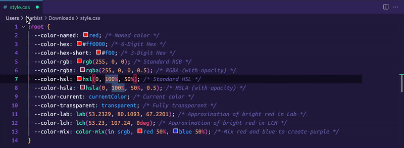

# OKLCHanger!

OKLCHanger! is a VS Code extension that converts colors in your code to `oklch()`.

I use OKLCH in all my projects now. Converting old colors by hand got boring fast, so I built this.

## Usage

1. Select the code you want to convert. Select nothing to convert the whole file.
2. Open the command palette (`Cmd+Shift+P` on Mac, `Ctrl+Shift+P` on Windows and Linux).
3. Run `OKLCHanger!`.

That's it. Every color in the selection is now an `oklch()` value.

## Features

- It works with one selection, many selections, or the whole file.
- It converts every color in multi-value properties, like `background: linear-gradient(red, #00f)`.
- It skips color names inside identifiers, like `.b-color-blue`, `--red`, `$red`, or `tan()`.
- It tells you which colors it couldn't convert.

## Supported colors

- Named colors, like `red`, `cornflowerblue`, or `rebeccapurple`
- Hex, like `#f00`, `#ff0000`, or `#ff0000ff`
- `rgb()` and `rgba()`, like `rgb(255, 0, 0)` or `rgb(255 0 0 / 50%)`
- `hsl()` and `hsla()`, like `hsl(0, 100%, 50%)` or `hsl(0 100% 50% / 1)`
- `hwb()`, like `hwb(0 0% 0%)`
- `lab()`, like `lab(50% 75 60)`
- `lch()`, like `lch(53% 105 40)`
- `oklab()`, like `oklab(0.6 0.2 0.1)`
- `oklch()`, like `oklch(0.6 0.25 20)`
- `color()`, like `color(display-p3 1 0 0)`

Both the old comma syntax and the modern space syntax work.

## Output

Lightness and chroma have 3 decimals. Hue has 2. For example, `red` becomes `oklch(0.628 0.258 29.23 / 1)`.

## Settings

| Setting | Default | Description |
| --- | --- | --- |
| `oklchConverter.useOpacity` | `true` | Add the `/ alpha` part to every color. If you turn it off, only colors with opacity below 1 get it. |

## License

MIT. See [LICENSE](https://raw.githubusercontent.com/maliMirkec/oklchanger/refs/heads/master/LICENSE.md).

> Built with assistance of Claude Code.
